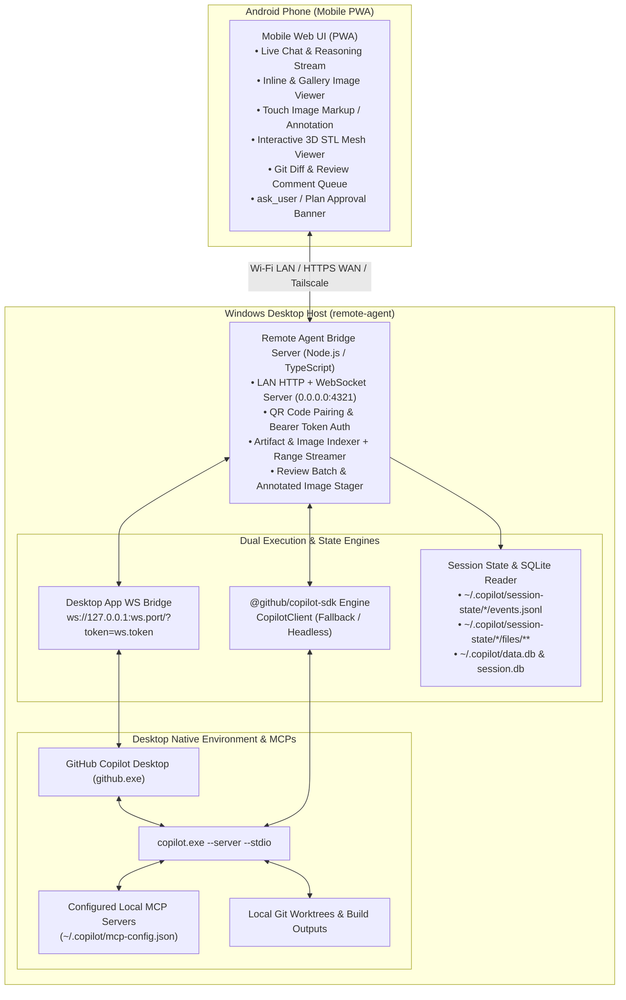
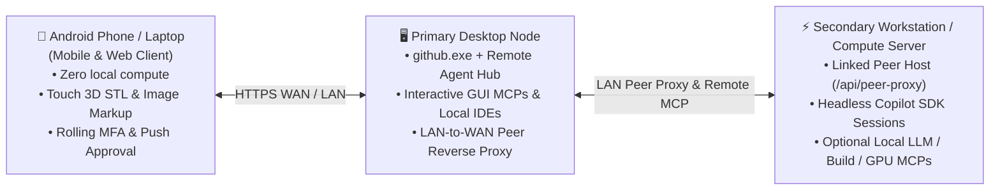

# Remote Agent: Mobile Companion for Desktop GitHub Copilot Sessions

## 1. Problem Statement & Motivation

When running complex engineering workflows in GitHub Copilot on a Desktop—such as local build/test pipelines, database/container orchestration, browser automation, 3D/CAD modeling, hardware debugging, or multi-repo worktree orchestration—the session depends heavily on **desktop-local resources**:

1. **Local MCP Servers & Native Software**: Local MCP servers configured in `~/.copilot/mcp-config.json`, native desktop applications, local serial/bus hardware, and local GPU/CPU toolchains only exist on the desktop machine.
2. **Rich Visual & 3D Artifacts**: Sessions generate high-resolution screenshots and renders (`.png`, `.jpg`), 3D meshes (`.stl`, `.obj`), inspection reports (`.md`, `.json`), and workspace diffs across both `~/.copilot/session-state/<id>/files/` and local Git worktrees.
3. **Enterprise Cloud Limitations**: Enterprise accounts may not have GitHub Cloud remote sessions enabled, and cloud-hosted sandboxes cannot access local desktop applications or hardware-bound MCPs.

**Goal**: Allow an Android phone or secondary computer (over LAN or WAN) to view **all running and historical desktop sessions in real time**, inspect generated images, 3D STL models, markdown artifacts, and Git diffs, and **steer/comment/annotate** remotely while all execution and MCP tool calls continue running natively on the Desktop.

---

## 2. System Discovery & Key Insights

Investigation of the local GitHub Copilot Desktop (`github.exe`) and CLI (`copilot.exe` / `@github/copilot-sdk`) environment revealed three complementary integration surfaces:

1. **GitHub Copilot Desktop App Loopback Bus (`~/.copilot/run/ws.port` & `ws.token`)**:
   - `github.exe` runs an authenticated loopback WebSocket server on `127.0.0.1:<ws.port>`.
   - Connecting with `ws://127.0.0.1:<ws.port>/?token=<ws.token>` (without a browser `Origin` header) provides a live bidirectional control channel to the Desktop App:
     - **Real-time Event Broadcast**: Streams `session_event` frames (`assistant.message_delta`, `assistant.reasoning_delta`, `tool.execution_start`, `tool.execution_complete`, `external_tool.requested`, `user_input_request`, `exit_plan_mode_request`, etc.) across all active sessions.
     - **Live Session Steering**: Accepts `send_message` (with `session_id`, `prompt`, `delivery_mode`: `"immediate"` | `"enqueue"`, `mode`: `"interactive"` | `"plan"` | `"autopilot"`, and `attachments`: `[{ type: "file", path }]`).
     - **Interactive Prompts & Plan Approvals**: Accepts `respond_to_user_input`, `respond_to_exit_plan_mode`, `respond_to_permission`, `set_session_mode`, `set_session_model`, `abort_session`, and `save_inline_review_comment`.
2. **On-Disk Session State & Databases (`~/.copilot/`)**:
   - `~/.copilot/session-state/<session-id>/events.jsonl`: Complete append-only JSONL event log for every session.
   - `~/.copilot/session-state/<session-id>/workspace.yaml`: Session metadata (`cwd`, `repository`, `branch`, `name`, timestamps).
   - `~/.copilot/session-state/<session-id>/files/` & `checkpoints/`: Persistent session artifacts (images, `.stl` meshes, `.md` reports, `.json` audits).
   - `~/.copilot/session-state/<session-id>/session.db`: Per-session SQLite database (`todos`, `todo_deps`).
   - `~/.copilot/data.db`: Desktop App SQLite database tracking `projects`, `workspaces`, `sessions`, `inline_review_comments`, and `review_threads`.
   - `~/.copilot/mcp-config.json`: User-configured local and remote MCP servers.
3. **GitHub Copilot SDK (`@github/copilot-sdk`)**:
   - Bundled locally at `%LOCALAPPDATA%\Programs\GitHub Copilot\copilot-sdk` and spawns `copilot.exe --server`.
   - Enables direct `CopilotClient` session resumption (`resumeSession(sessionId)`) and creation (`createSession(config)`) with full `~/.copilot/mcp-config.json` MCP server injection when the Desktop GUI (`github.exe`) is not running.

---

## 3. High-Level Architecture

---

## 4. Core Subsystems

### 4.1 Desktop App WebSocket Bridge (`DesktopAppBridge`)
- Automatically discovers `~/.copilot/run/ws.port` and `~/.copilot/run/ws.token`.
- Maintains a persistent, auto-reconnecting WebSocket connection to `github.exe`.
- Forwards live `session_event`, `workspace_list`, `user_input_request`, `exit_plan_mode_request`, and `session_state_result` messages to connected mobile clients.
- Executes mobile-initiated actions directly inside the Desktop App:
  - **Send Prompt / Comment**: `send_message` with `delivery_mode: "immediate"` (steers active session at next turn boundary) or `"enqueue"` (waits for current turn to finish).
  - **Send Annotated Images / Camera Photos**: Writes base64 image uploads from mobile to `~/.copilot/attachments/remote-agent/<session-id>/<timestamp>.png` and attaches them via `attachments: [{ type: "file", path }]`.
  - **Answer Blocked Questions**: `respond_to_user_input` (`session_id`, `request_id`, `answer`, `was_freeform`).
  - **Approve / Reject Plans**: `respond_to_exit_plan_mode` (`session_id`, `request_id`, `approved`, `feedback`, `selected_action`).
  - **Switch Mode / Model / Abort**: `set_session_mode`, `set_session_model`, `abort_session`.

### 4.2 Session State Watcher & Artifact Indexer (`SessionStateStore`)
- Reads `~/.copilot/data.db` (read-only) and scans `~/.copilot/session-state/` to build a unified list of all sessions (active, idle, project worktrees, and general chats).
- Parses `events.jsonl` into structured conversation turns (`user.message`, `assistant.message`, `reasoningText`, `toolRequests`, `toolResults`, `usage`, sub-agent calls, and pending `ask_user` / `exit_plan_mode` states).
- Watches active `events.jsonl` files for byte-offset incremental tailing so even if a session runs outside `github.exe`, mobile clients receive real-time events.
- **Deep Artifact Discovery**:
  1. Recursively scans `~/.copilot/session-state/<id>/files/` and `checkpoints/`.
  2. Extracts file paths referenced in `events.jsonl` tool calls (`view`, `create`, `edit`, `powershell`, and MCP tool calls) and assistant messages (e.g., `.png` screenshots/renders, `.stl` meshes, or `.apk`/`.exe` binaries written into workspace folders).
  3. Scans recent modified/untracked media and document files in the session's workspace worktree.
  4. Validates all artifact paths against an allowlist of root directories (`~/.copilot/` and the user's configured project/worktree roots) before serving them over HTTP.

### 4.3 `@github/copilot-sdk` Standalone Fallback (`CopilotSdkEngine`)
- Dynamically loads `@github/copilot-sdk` from `%LOCALAPPDATA%\Programs\GitHub Copilot\copilot-sdk` (or `node_modules`).
- When a target session is not managed by a running `github.exe` instance (or if `github.exe` is closed), uses `CopilotClient` to `resumeSession(sessionId)` with `~/.copilot/mcp-config.json` MCP servers enabled.

### 4.4 Mobile Companion PWA (Android-First Web Client)
- **Zero-Friction Pairing**:
  - Server prints LAN URLs and a scannable QR code on startup, and exposes a `/pair` screen on desktop.
  - Scanning the QR code on Android opens `http://<desktop-lan-ip>:4321/?token=<pairing-token>`, stores the token in `localStorage` + `HttpOnly` cookie, and strips it from the URL bar.
- **Mobile-Optimized Views**:
  1. **Sessions List**: Live status badges (`Running / Busy`, `Needs Input`, `Plan Review`, `Idle`), project/branch badges, token/context meter, and dynamically discovered Desktop MCP server indicators from `~/.copilot/mcp-config.json`.
  2. **Live Conversation & Tool Stream**:
     - Renders Markdown, code blocks, and collapsible reasoning traces.
     - Displays compact, expandable **MCP & Tool Call Pills** (`powershell`, `view`, `edit`, and any configured MCP server tools).
     - **Inline Visual Cards**: Automatically embeds clickable image previews and 3D `.stl` preview cards directly inside the chat turn whenever a tool call or message references or generates a file!
     - **Interactive Prompt & Plan Banner**: When a session is waiting on `ask_user` or plan approval, presents one-tap choice buttons or freeform reply right above the composer.
  3. **Artifacts & 3D/Media Gallery**:
     - Category filters: `All`, `Images`, `3D / CAD (.stl)`, `Docs (.md)`, `Data / Code`.
     - **Interactive 3D STL Viewer**: WebGL/Canvas 3D mesh renderer supporting touch orbit, pinch-to-zoom, pan, wireframe overlay, and normal/shaded lighting so CAD exports can be inspected from every angle on Android.
     - **Image Lightbox & Touch Annotation Studio**: Pinch-zoom image viewer with a built-in drawing canvas (freehand pen, arrow, rectangle, text label, color picker). Tap **"Send Markup to Copilot"** to rasterize the annotated image and send it with your comment directly into the Desktop session!
  4. **Git Diff & Review Comment Queue**:
     - Inspect modified files and unified diffs in the session's worktree.
     - Tap any diff line or artifact to add a **Review Comment** to a persistent mobile review batch (or save directly to Desktop `inline_review_comments`).
     - Tap **"Send Review Feedback (N)"** to format all queued comments with file/line/artifact context and dispatch them as a single steering turn to the Desktop agent.

---

## 5. Security & WAN Evolution Roadmap

### Phase 1: Local Network (LAN) — Implemented
- **Network Binding**: Listens on `0.0.0.0:4321` (configurable via `PORT` / `HOST`).
- **Authentication**: 256-bit random bearer token persisted in `~/.copilot/remote-agent-auth.json`. Required on all `/api/*` HTTP endpoints and `/ws` WebSocket upgrades.
- **Path Traversal Protection**: Artifact serving (`GET /api/sessions/:id/artifact`) resolves canonical real paths and strictly enforces that the file resides within `~/.copilot/session-state`, `~/.copilot/attachments`, or a registered workspace/project directory from `data.db`.

### Phase 2: Wide Area Network (WAN) & Single-Port TLS Multiplexing — Implemented
- **Single-Port HTTP + HTTPS Multiplexer (`src/server.ts` + `src/tls.ts`)**:
  - A raw TCP front listener (`net.createServer`) on port `4321` inspects the first byte of each incoming connection:
    - `0x16` (TLS ClientHello) is piped to the internal `https.Server` (`~/.copilot/tls/cert.pem` & `key.pem`, supporting publicly trusted Let's Encrypt certificates as well as auto-generated fallback certs).
    - All other bytes (`G`, `P`, `O`, `D`, `H` HTTP methods) are piped to the internal `http.Server`.
  - Both `https://<wan-domain>:4321` (`wss://`) and `http://<lan-ip>:4321` (`ws://`) operate simultaneously on port `4321`.
- **Option A: Built-In 1-Click Cloudflare HTTPS Tunnel (`src/wan-tunnel.ts`)**:
  - Automatically downloads `cloudflared.exe` (`~/.copilot/bin/cloudflared.exe`) and spawns `cloudflared tunnel --url http://127.0.0.1:4321`.
  - Never bypasses token authentication when proxy headers (`CF-Connecting-IP`, `X-Forwarded-For`, `X-Forwarded-Proto`) are present.
- **Option B: Direct Router Port-Forwarding + Dynamic DNS + Hairpin NAT**:
  - Forwarding TCP `4321 -> <desktop-lan-ip>:4321` with Hairpin NAT allows the exact same `https://remote.example.com:4321` URL to work seamlessly on both home Wi-Fi and cellular 5G.
- **Option C: Overlay Mesh VPN (Tailscale / WireGuard)**:
  - Automatically detects `100.x.y.z` Tailscale IPv4 addresses and includes them in `/api/pair-info`.

---

## 5.5 Performance, Isolation & Multi-Desktop Architecture

1. **Strict Per-Session Artifact Isolation (`isPathOwnedBySession`)**:
   - Every artifact discovered from `files/`, `checkpoints/`, or `events.jsonl` tool references is validated against the owning session's `~/.copilot/session-state/<id>`, `~/.copilot/attachments/remote-agent/<id>`, or that session's dedicated worktree `cwd`. Artifacts from other sessions never bleed across sessions.
2. **Large `events.jsonl` Fast-Path & In-Memory Caching**:
   - `getSessionConversationAndArtifacts()` skips multi-megabyte non-conversation records (`session.binary_asset`, `hook.start`, `hook.end`, `session.usage_record`) prior to `JSON.parse()`, parsing 30+ MB session logs in ~80ms cold and `0ms` warm via `sessionDetailCache` keyed by `(eventsSize, eventsMtimeMs)`.
   - On the client (`src/public/app.js`), Frame-1 `localStorage` hydration + background prefetching of top sessions (`schedulePrefetchTopSessions`) makes switching sessions instantaneous.
3. **Multi-Desktop & Multi-Account Support**:
   - Reads configured GitHub accounts (`accounts` table in `~/.copilot/data.db`) and tags each session with its `@accountLogin`.
   - Stores peer desktop hosts in `~/.copilot/remote-agent-peers.json` (`GET/POST/DELETE /api/peers`) and renders a 1-tap `#hostSwitcherStrip` in the mobile drawer.
4. **Full Model / Reasoning / Context Switching & Interrupted Prompt Recovery**:
   - `POST /api/sessions/:id/config` updates `model`, `reasoning_effort`, `context_tier`, and `mode` in `~/.copilot/data.db` and dispatches `set_session_model` / `set_session_mode` to `github.exe`.
   - When answering an `ask_user` or `exit_plan_mode` prompt on a session that was previously interrupted or idle, `POST /api/sessions/:id/respond-input` and `respond-plan` automatically dispatch `send_message` alongside `respond_to_user_input` so the interrupted session wakes up and resumes immediately with the user's answer.
5. **Live UI Hot-Reload & Asset Versioning**:
   - Computes a content SHA-1 (`uiVersion`) across `src/public/{index.html,styles.css,app.js}`, injects `?v=<uiVersion>` into served HTML with `Cache-Control: no-store`, and broadcasts `{ type: "ui_reload", uiVersion }` over WebSocket whenever `src/public/` files are updated.

---

## 6. Multi-Machine & Remote Compute Server Topology

When operating across multiple machines—such as a primary interactive Desktop alongside one or more secondary desktops or headless compute/GPU servers—the architecture scales into a **3-Tier Hybrid Topology**:

### Multi-Node Capabilities:
1. **Primary Desktop Hosts Interactive GUI Sessions**:
   - Interactive desktop applications and GUI-bound MCP servers remain on the primary workstation while being steerable from mobile.
2. **LAN-to-WAN Peer Reverse Proxy (`/api/peer-proxy/:peerId/*`)**:
   - Additional desktops or headless servers on the local network register with the primary desktop hub (`POST /api/peers` or `npm run join`).
   - Mobile clients connected to the primary desktop over a single WAN port (`4321`) can switch between all linked machines in one tap without requiring separate router port-forwards or TLS certificates per machine.
3. **Optional Local Model & Compute Offload**:
   - Compute-heavy or GPU-backed servers can also host custom model providers (`llama.cpp`, `vLLM`, `Ollama`) or remote HTTP/SSE MCP servers registered in `~/.copilot/mcp-config.json`.

